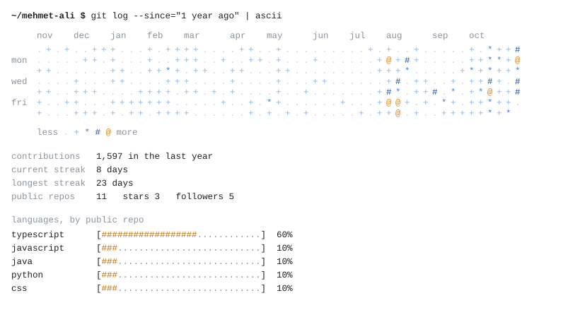

  <picture>
    <source media="(prefers-color-scheme: dark)" srcset="./assets/header-golden.gif">
    
  </picture>

<pre>
  <b>~/mehmet-ali $</b> whoami

  ┌────────────────────────────────────────────────────────────────┐
  │                                                                │
  │   <b>mehmet ali öztürk</b>                                            │
  │   frontend developer · software engineering student            │
  │   istanbul, turkey                                             │
  │                                                                │
  │   > freelance frontend developer @ wpp production  2025 - now  │
  │   > building my own products: sporliyo, nullsect   2025 - now  │
  │   > software engineering @ altinbas university     2023 - now  │
  │                                                                │
  └────────────────────────────────────────────────────────────────┘
</pre>

<pre>
  <b>~/mehmet-ali $</b> cat now.txt

    - localizing global client websites for international markets
    - fixing layout shifts and responsive bugs on production pages
    - shipping sporliyo (web + ios + android) and nullsect (fivem)
</pre>

<pre>
  <b>~/mehmet-ali $</b> ls ~/projects

  * <b>sporliyo</b> .......................................... <a href="https://sporliyo.com">sporliyo.com</a>
    multi-tenant saas for football schools, with ios + android apps
    next.js · typescript · neon postgres · capacitor · vercel blob

  * <b>nullsect</b> .......................................... <a href="https://nullsect.dev">nullsect.dev</a>
    fivem script studio: tebex storefront + 30 lua resources
    next.js · three.js · gsap · lua · qbox/qbcore · tebex

  * <b>westlapd</b> .......................................... <a href="https://westlapd.com">westlapd.com</a>
    police department system: 15 modules, 12 roles, 60+ permissions
    next.js · supabase · jwt · amazon s3 · tiptap · excalidraw

  * <b>istanbul minare</b> ............................. <a href="https://istanbulminare.com/">istanbulminare.com</a>
    corporate site for a mosque and minaret restoration company
    next.js · tailwind · framer motion · react lenis

  * <b>movier</b> .................................. <a href="https://movier-nine.vercel.app">movier-nine.vercel.app</a>
    swipe-based movie discovery with watchlist sync · <a href="https://github.com/mehmetali-ozturk/movier">source</a>
    next.js · supabase · tmdb api · framer motion

  * <b>portfolio</b> ....................................... <a href="https://mehmetali.tech">mehmetali.tech</a>
    personal portfolio with a cinematic, motion-heavy ui
    react · vite · typescript · css modules
</pre>

<pre>
  <b>~/mehmet-ali $</b> tree ~/stack

  stack/
  ├── frontend  react  next.js  typescript  javascript  tailwind
  │             html  css
  ├── motion    framer motion  gsap  three.js  lenis
  ├── backend   node.js  supabase  postgresql  neon  amazon s3
  ├── mobile    capacitor  firebase cloud messaging
  ├── game      lua  fivem  qbox / qbcore  nui
  ├── testing   vitest  playwright
  ├── ship      git  github  vercel
  └── school    java  c
</pre>

  <picture>
    <source media="(prefers-color-scheme: dark)" srcset="./assets/stats-dark.svg">
    
  </picture>

<pre>
                                   .
                         \         |         /
                           \       |       /
                  .          _..-------.._          .
             --          .-'               '-.          --
       ~~~~~~~~~~~~~~~~~/~~~~~~~~~~~~~~~~~~~~~\~~~~~~~~~~~~~~~~~
         ~~~~    ~~~~~     ~~~   * ~ *   ~~~     ~~~~~    ~~~~
              ~~~~~    ~~~     ~ * . * ~     ~~~    ~~~~~
                   ~~~~    ~~    * . *    ~~    ~~~~

              <i>the sun will rise and i get to try again.</i>
</pre>

<pre>
  <b>~/mehmet-ali $</b> ping mehmet-ali

    web        <a href="https://mehmetali.tech">mehmetali.tech</a>
    linkedin   <a href="https://www.linkedin.com/in/mehmet-ali-ozturk-/">in/mehmet-ali-ozturk-</a>
    github     <a href="https://github.com/mehmetali-ozturk">@mehmetali-ozturk</a>
    mail       <a href="mailto:mehmetali.ozturk@hotmail.com">mehmetali.ozturk@hotmail.com</a>
</pre>

header and stats drawn in ascii · stats refresh daily · <a href="https://mehmetali.tech">mehmetali.tech</a>

